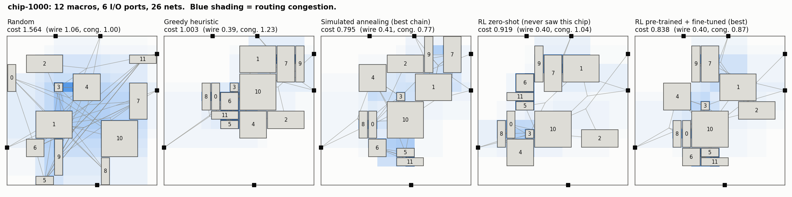
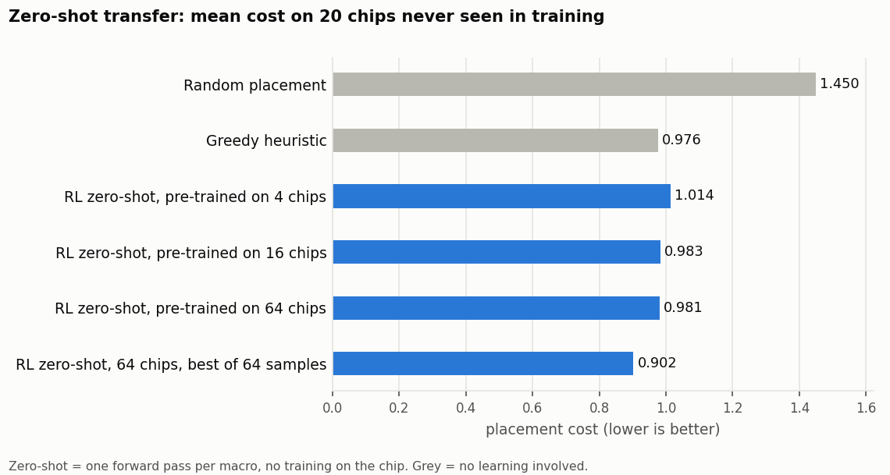

# mini-AlphaChip

**A weekend-sized, laptop-CPU re-implementation of the idea behind Google's AlphaChip**: deep
reinforcement learning for chip macro placement, from
[Mirhoseini, Goldie et al., *"A graph placement methodology for fast chip design"*, Nature 594 (2021)](https://www.nature.com/articles/s41586-021-03544-w).
Google reports using this method for the floorplans of its recent TPU generations.


About 900 lines of PyTorch for the library, 1,250 with experiments and tests. No GPU.
All 12 training runs behind the numbers below finish in **18 minutes on a 10-core laptop**.

## The idea in one paragraph

A chip block is a **netlist**: big memory blocks (*macros*), logic gates (*standard cells*) and
the wires (*nets*) between them. *Floorplanning* means putting the macros on a 2-D canvas so that
wires are short, routing is not congested and nothing overlaps. AlphaChip turns this into a
**game**. The agent places macros **one at a time**, largest first, on a grid. Illegal cells are
masked out. Only after the last macro does it get a reward: `-(wirelength + λ·congestion)`.
The policy reads the netlist with an **edge-based graph neural network** and is trained with
**PPO**. The paper's key claim is about transfer: an agent **pre-trained on many chips** places a
*new* chip faster than one that starts from scratch.

## What is reproduced, and what is not

| Paper (Nature 2021) | mini-AlphaChip |
|---|---|
| MDP: place macros sequentially, largest first, reward only at the end | same ([`env.py`](minichip/env.py)) |
| Action = grid cell; infeasible cells masked (density as a hard constraint) | same |
| Proxy wirelength: normalised HPWL | same |
| Proxy congestion: routing demand per cell, mean of the top 10% | RUDY-style H/V demand, mean of the top 10% |
| Edge-GNN encoder: `e_ij = fc(v_i ‖ v_j)`, `v_i = mean_j w_ij e_ij` | same ([`model.py`](minichip/model.py)) |
| Deconvolution policy head + value head | same, plus a small CNN over the canvas |
| PPO | PPO, with a per-chip reward baseline for multi-chip pre-training |
| Pre-train on 20 TPU blocks, then zero-shot / fine-tune on an unseen block | pre-train on 4 / 16 / 64 synthetic chips, then zero-shot / fine-tune on unseen chips |
| Baselines: human experts, RePlAce, simulated annealing | random, greedy, simulated annealing |
| Real netlists, up to 128×128 grid, hundreds of macros, standard cells placed by a force-directed method | 16×16 grid, 12 macros, 6 I/O ports, ~26 nets, **no standard cells** |

One deliberate addition that is **not** in the Nature paper: the canvas input includes a
**wire mask**, a map of how much wirelength the current macro would add at each cell. It comes
from [MaskPlace (Lai et al., NeurIPS 2022)](https://arxiv.org/abs/2211.13382). The ablation below
shows how much it matters at this scale.

## Results

Everything is scored with one cost model: `cost = normalised HPWL + 0.5 × congestion`, lower is
better. Hyper-parameters (learning rate, entropy bonus, annealing schedule) were chosen on a
separate development chip (`chip-900`), not on the chips reported here.
Raw numbers: [`results/summary.md`](results/summary.md), [`results/results.json`](results/results.json),
log: [`results/train_log.txt`](results/train_log.txt).

### A. One unseen chip, equal search budget

`chip-1000` is never seen during pre-training. Every method may evaluate 12,800 placements.


Best cost found after N placement evaluations (mean ± std over runs):

| Method | N = 64 | N = 1,024 | N = 4,096 | N = 12,800 |
|---|---:|---:|---:|---:|
| Random search | 1.099 | 1.055 | 0.930 | 0.930 |
| Simulated annealing (8 chains) | 1.148 ± 0.067 | 0.958 ± 0.032 | 0.881 ± 0.013 | **0.803 ± 0.007** |
| RL from scratch, no wire mask (3 seeds) | 1.138 ± 0.015 | 1.037 ± 0.015 | 0.931 ± 0.002 | 0.924 ± 0.011 |
| RL from scratch (3 seeds) | 1.138 ± 0.015 | 0.899 ± 0.010 | **0.817 ± 0.017** | 0.812 ± 0.019 |
| RL pre-trained on 64 chips + fine-tuned (3 seeds) | **0.890 ± 0.010** | **0.862 ± 0.003** | 0.847 ± 0.005 | 0.843 ± 0.004 |

For reference: the greedy heuristic scores 1.003 with one placement, and the pre-trained policy
scores 0.919 with one placement (zero-shot, argmax). Best single runs: annealing 0.795,
RL from scratch 0.796, RL fine-tuned 0.838.



What the numbers say:

1. **Pre-training buys speed.** With no training on this chip, the pre-trained policy's first
   64 samples reach 0.890. Random search never gets there in 12,800 tries, annealing needs
   about 3,500 evaluations, and RL from scratch about 1,200.
2. **Pre-training did not buy final quality here.** Fine-tuning plateaus at 0.843 in all three
   seeds, behind RL from scratch (0.812) and annealing (0.803). The pre-trained policy is
   already confident, so it stops exploring early. A higher entropy bonus or a reset policy
   head during fine-tuning are the obvious next things to try; I did not tune this on the
   reported chip.
3. **RL from scratch is the most sample-efficient search in the middle of the budget.**
   At 4,096 evaluations it is at 0.817, where annealing is still at 0.881.
4. **At the full budget, annealing and RL from scratch are tied.** 0.803 ± 0.007 versus
   0.812 ± 0.019 is within run-to-run noise, and the best runs are 0.795 and 0.796.
5. **The wire mask matters a lot at this scale.** Without it, RL from scratch ends at 0.924,
   no better than random search with the same budget.

### B. Zero-shot transfer to 20 unseen chips

The pre-trained policy places each chip with one forward pass per macro and no training on it.



| Method | Mean cost over 20 held-out chips |
|---|---:|
| Random placement | 1.450 |
| Greedy heuristic | 0.976 |
| RL zero-shot, pre-trained on 4 chips | 1.014 |
| RL zero-shot, pre-trained on 16 chips | 0.983 |
| RL zero-shot, pre-trained on 64 chips | 0.981 |
| RL zero-shot, 64 chips, best of 64 samples | **0.902** |

- **More training chips help, then level off**: 1.014 → 0.983 → 0.981 for 4 → 16 → 64 chips.
- **A single argmax pass only ties the greedy heuristic** (0.981 versus 0.976; it wins on 8 of
  20 chips). This is not the paper's "superhuman zero-shot".
- **Sampling 64 placements from the policy beats greedy on 19 of 20 chips**, by 7.6% on average.

## Run it

```bash
python3 -m venv .venv && source .venv/bin/activate
pip install -r requirements.txt
python tests/test_env.py              # cost model vs. a slow reference implementation
python run_experiments.py --quick     # smoke test, under a minute
python run_experiments.py             # full run: 12 training runs in parallel, ~18 min on 10 cores
python make_figures.py                # figures/ and results/summary.md
```

`checkpoints/` holds the pre-trained policies (4, 16 and 64 chips) and the three fine-tuned ones.

## Code map

```
minichip/
  netlist.py    synthetic netlists; Batch = padded tensors for B placements at once
  env.py        the MDP and the cost model, fully vectorised (HPWL, RUDY congestion, masks)
  model.py      Edge-GNN encoder, deconvolution + CNN policy head, value head
  rl.py         batched rollouts and PPO
  baselines.py  random, greedy, parallel simulated annealing
  jobs.py       one training run = one job; runs jobs on separate CPU cores
  viz.py        figures and the animation
run_experiments.py   experiments A, B and the ablation
make_figures.py      results.json -> figures and summary table
tests/test_env.py    vectorised cost model checked against naive loops
```

## Caveats

- **Toy scale.** 12 macros on 256 cells is a puzzle, not a chip. At this scale a tuned simulated
  annealer is a very strong baseline. That kind of comparison is also at the centre of the
  published debate about the paper (Cheng et al., *"Assessment of Reinforcement Learning for
  Macro Placement"*, ISPD 2023; Google's reply *"That Chip Has Sailed"*, arXiv:2411.10053).
  Nothing here settles that debate.
- **Proxy cost only.** The paper's final numbers come from a commercial EDA flow (timing, power,
  area). Here the proxy cost is the metric.
- **Small statistics.** Three RL seeds and eight annealing chains on one target chip; twenty
  chips for the zero-shot comparison.
- **Synthetic netlists** from one generator, so "unseen chip" means a new sample from the same
  distribution, not a different kind of design.

## References

- A. Mirhoseini, A. Goldie et al. *A graph placement methodology for fast chip design.* Nature 594, 207–212 (2021), and its 2024 addendum.
- Google DeepMind, [*How AlphaChip transformed computer chip design*](https://deepmind.google/discover/blog/how-alphachip-transformed-computer-chip-design) (2024).
- Official implementation: [google-research/circuit_training](https://github.com/google-research/circuit_training).
- Y. Lai et al. *MaskPlace: Fast Chip Placement via Reinforced Visual Representation Learning.* NeurIPS 2022.
- J. Schulman et al. *Proximal Policy Optimization Algorithms.* arXiv:1707.06347 (2017).

---

### Türkçe özet

Google'ın TPU çiplerinin yerleşim planlarında kullandığı AlphaChip yönteminin (Nature 2021)
dizüstü bilgisayarda çalışan küçük bir yeniden üretimi. Ajan makroları ızgaraya tek tek
yerleştiriyor, ödülü yalnızca en sonda alıyor: −(kablo uzunluğu + sıkışıklık). Politika
Edge-GNN tabanlı, eğitim PPO ile. Bulgular: 64 çipte ön-eğitilen ajan, hiç görmediği bir çipte
ilk 64 denemesinde, rastgele aramanın 12.800 denemede ulaşamadığı sonuca ulaşıyor; ama
fine-tuning erken plato yapıyor ve nihai kalitede sıfırdan eğitilen ajan ile simulated
annealing'in gerisinde kalıyor. Tam bütçede sıfırdan RL ile simulated annealing berabere.

Built with Claude (Fable 5.2) as part of a weekend-project series. MIT License.
