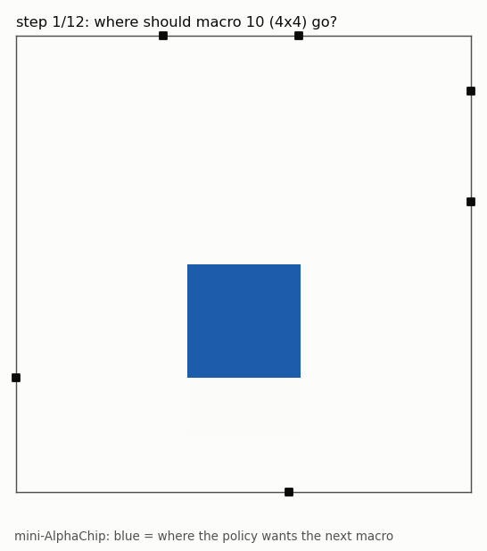
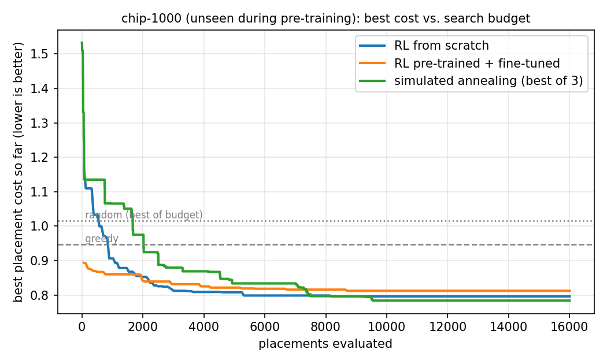

# mini-AlphaChip

**A weekend-sized, laptop-CPU re-implementation of the core idea behind Google's AlphaChip** —
deep reinforcement learning for chip macro placement, as described in
[Mirhoseini, Goldie et al., *"A graph placement methodology for fast chip design"*, Nature 594, 2021](https://www.nature.com/articles/s41586-021-03544-w)
(the method Google says it has used for the floorplans of several TPU generations).



~800 lines of PyTorch + NumPy. Full experiment suite runs in about 30 minutes on a 4-core laptop, no GPU.

---

## The idea in one paragraph

A chip block is a **netlist**: a hypergraph of big memory blocks (*macros*), millions of logic
gates (*standard cells*) and the wires (*nets*) between them. *Floorplanning* means putting the macros
onto a 2-D canvas so that wires are short, routing is not congested and nothing overlaps.
AlphaChip turns this into a **game**: the agent places macros **one at a time** (largest first) onto
a grid; illegal cells are masked out; after the last macro the placement is scored and the agent
gets a single reward `-(wirelength + λ·congestion + γ·density)`. A policy network built on an
**edge-based graph neural network** reads the netlist, is trained with **PPO**, and — the key
claim — when **pre-trained on many chips** it places a *new* chip better and faster than an agent
trained from scratch.

## What this repo reproduces (and what it doesn't)

| Paper (Nature 2021)                                                | mini-AlphaChip                                                        |
|--------------------------------------------------------------------|-----------------------------------------------------------------------|
| MDP: place macros sequentially, largest first, reward only at the end | same (`minichip/env.py`)                                            |
| Action = grid cell, infeasible cells masked (density as hard constraint) | same — overlap mask via 2-D prefix sums                           |
| Proxy wirelength: normalised HPWL                                   | same                                                                 |
| Proxy congestion: routing demand per cell, mean of top-10% cells    | RUDY-style H/V demand, mean of top-10% cells                         |
| Edge-GNN encoder: `e_ij = fc(v_i ‖ v_j)`, `v_i = mean_j e_ij`        | same, on a weighted clique adjacency (`minichip/model.py`)           |
| Deconvolution policy head over the grid + value head                | same, plus a small CNN over the canvas (helps a tiny model on CPU)   |
| PPO                                                                 | PPO with clipping, entropy bonus, terminal-reward advantages         |
| Pre-train on 20 TPU blocks → zero-shot / fine-tune on unseen block  | pre-train on 64 synthetic netlists → zero-shot / fine-tune on unseen |
| Baselines: human experts, RePlAce, simulated annealing              | random, greedy, simulated annealing (swap/shift moves, paper-style) |
| Real TPU / Ariane netlists, 128×128 grid, hundreds of macros, std-cell clusters placed by force-directed method | 16×16 grid, 12 macros, 6 I/O ports, ~26 nets, **no standard cells** |

So: same *formulation*, *reward*, *architecture family* and *training recipe*, on a toy problem.
Numbers here say nothing about real chips — see "Honest caveats" below.

## Results

Target chip `chip-1000` is **never seen during pre-training**. Every search method gets the same
budget: **16,000 placement evaluations**. Cost = normalised HPWL + 0.5 × congestion (lower is better).
Full log: [`results/train_log.txt`](results/train_log.txt), numbers: [`results/results.json`](results/results.json).



| Method on `chip-1000`                                   | Best cost | Placements needed |
|---------------------------------------------------------|----------:|------------------:|
| Random (best of 16k)                                    | 1.017     | 16,000            |
| Greedy (min. wirelength, same macro order)              | 0.947     | 1                 |
| **RL zero-shot** (pre-trained, 1 forward pass/macro)    | 0.970     | **1**             |
| **RL zero-shot**, best of 64 samples                    | 0.890     | **64**            |
| RL pre-trained + fine-tuned                             | 0.812     | 16,000            |
| RL from scratch                                         | 0.796     | 16,000            |
| Simulated annealing (mean / best of 3 seeds)            | 0.802 / **0.784** | 16,000 each |


**What I observed**

1. **The RL formulation works.** Trained from scratch, the agent beats a wirelength-greedy placer
   by 16% and random search by 22%, and lands within 1.5% of the best simulated-annealing run
   (on par with the SA average).
2. **Pre-training gives a big head start.** With no training on the chip, the pre-trained
   agent's *first 64 samples* (0.890) already beat greedy and 16k random placements. The
   from-scratch agent needs about 1,300 placements to get there, SA about 2,500.
3. **…but in my run it then plateaued.** Fine-tuning converged early (the pre-trained policy
   was already low-entropy) and finished 2% behind the from-scratch agent. The paper fine-tunes
   for hours with tuned hyper-parameters; here it's one seed and default PPO settings. More
   entropy during fine-tuning is the obvious next thing to try.
4. **Zero-shot transfer across 8 unseen chips** (no fine-tuning at all):

| Chip      | Random (mean) | Greedy | RL zero-shot (argmax) | RL zero-shot (best of 64) |
|-----------|------:|-------:|-------:|-------:|
| chip-1000 | 1.389 | 0.947 | 0.970 | **0.885** |
| chip-1001 | 1.408 | 0.912 | 0.913 | **0.862** |
| chip-1002 | 1.402 | **0.783** | 0.848 | 0.840 |
| chip-1003 | 1.395 | 0.880 | 0.900 | **0.867** |
| chip-1004 | 1.422 | 0.983 | 0.981 | **0.928** |
| chip-1005 | 1.416 | **0.970** | 1.038 | 0.983 |
| chip-1006 | 1.510 | 1.060 | 0.996 | **0.986** |
| chip-1007 | 1.467 | 1.237 | 1.162 | **1.017** |
| **mean**  | 1.426 | 0.971 | 0.976 | **0.921** |

   A single greedy forward pass is about as good as the greedy heuristic. Sampling 64 placements from
   the pre-trained policy beats greedy on 6 of 8 unseen chips — a policy that learned *how to
   place*, not *where to place one chip*.

## Run it

```bash
python3 -m venv .venv && source .venv/bin/activate
pip install -r requirements.txt
python run_experiments.py --quick   # 2-minute smoke test
python run_experiments.py           # full run (~30 min CPU), writes results/ and figures/
```

`checkpoints/pretrained.pt` is the policy pre-trained on the 64-netlist corpus.

## Code map

```
minichip/
  netlist.py    synthetic netlists with hidden "functional unit" structure
  env.py        MDP: state features, feasibility mask, HPWL + congestion cost
  model.py      Edge-GNN encoder + deconv/CNN policy head + value head
  ppo.py        batched rollouts and the PPO update
  baselines.py  random, greedy, simulated annealing
  viz.py        placement plots, curves, GIF
run_experiments.py   the three experiments above
```

## Honest caveats

* **Toy scale.** 12 macros on 256 cells is a puzzle, not a chip. At this scale a well-tuned
  simulated annealer is a very strong baseline; it is exactly the kind of comparison that later
  sparked debate about the paper (Cheng et al., *"Assessment of Reinforcement Learning for Macro
  Placement"*, ISPD 2023, and Google's response *"That Chip Has Sailed"*, arXiv:2411.10053, 2024).
  This repo does not take a side in that debate — it is a learning project.
* **Proxy costs only.** The paper's final numbers come from a commercial EDA flow (timing, power,
  area). Here the proxy cost *is* the metric.
* **One seed per RL run** (to keep it a weekend project). Expect run-to-run variance.

## References

* A. Mirhoseini, A. Goldie, et al. *A graph placement methodology for fast chip design.* Nature 594, 207–212 (2021). Addendum: Nature (2024).
* Google DeepMind blog, *How AlphaChip transformed computer chip design* (Sept 2024).
* Official open-source implementation: [google-research/circuit_training](https://github.com/google-research/circuit_training).
* J. Schulman et al. *Proximal Policy Optimization Algorithms.* arXiv:1707.06347 (2017).

---

### Türkçe özet

Google'ın TPU çiplerinin yerleşim planlarında kullandığı AlphaChip yönteminin (Nature 2021) küçük
ölçekli, dizüstü bilgisayarda çalışan bir yeniden üretimi. Ajan, makroları ızgara üzerine tek tek
yerleştiriyor; bölüm sonunda kablo uzunluğu + yönlendirme sıkışıklığı cezasıyla ödüllendiriliyor;
politika Edge-GNN tabanlı ve PPO ile eğitiliyor. Birçok "çip" üzerinde ön-eğitilen ajanın, hiç
görmediği yeni bir çipi sıfırdan eğitilen ajandan daha hızlı ve daha iyi yerleştirip
yerleştirmediğini test ediyor.

MIT License.
